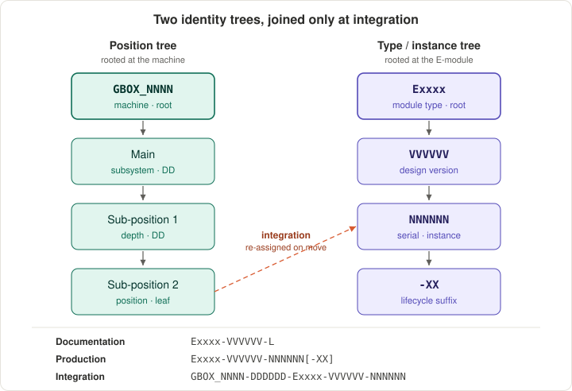

<!--
SPDX-FileCopyrightText: 2026 The IndustryGrow contributors
SPDX-License-Identifier: CC-BY-SA-4.0
-->

# ADR-0017 — Component, document and instance identification

- **Status:** Accepted
- **Date:** accepted 2026-05-31; changed 2026-10-19
- **Parent:** ADR-0001
- **Related:** ADR-0002 (carrier and module classes are E-modules; the `I` layer carries its Cyphal/DSDL definitions), ADR-0004 (the operational audit log this scheme does not duplicate), ADR-0007 (secure-element identity bound to the serial; the `-PR` record), ADR-0014 (module-class vocabulary; partial-BOM populations; gateway role and zone tagging), ADR-0015 (deployment profiles are profile-versioned, not suffix-addressed), ADR-0016 (instance mobility between deployments), ADR-0019 (the purchased-part `SP` root on the same identity axis), ADR-0021 (hosts the instance and integration layer), ADR-0022 (the one place the grammar is parsed), ADR-0023 (how the type registry is consumed), ADR-0008 (planned; a position root above the machine), ADR-IF-0001 (planned; `production_unit`, the platform counterpart of the depth code)

## Context

IndustryGrow produces a small set of reusable designs — the carrier and the module classes of ADR-0014 — instantiated many times, and instances move between positions and deployments as inventory (ADR-0016). Procurement, QC, calibration and provisioning records need a canonical key, and an instance's history must follow it across re-installations.

Three things must stay apart: the **type** (a design and its version), the **instance** (a serial), and the **position** in a machine. An identifier that fused type with position, or instance with position, breaks multi-instance scaling and instance mobility. The secure element on every carrier (ADR-0007) already provides a hardware identity, and IndustryFlow already holds firmware events, telemetry and forensic history (ADR-0004); the scheme binds to the first and does not duplicate the second.

Identity has two orthogonal axes that never fuse. The **identity axis** — what a thing is and which copy — is rooted at the E-module, `Exxxx → VVVVVV → NNNNNN`, assigned at design and production, and position-free. The **position axis** — where a thing sits — is rooted at the machine, `GBOX_NNNN → DDDDDD`, assigned at integration, and identity-free. They meet only in the integration identifier, a mutable cross-reference. The **document layer** is a classifier on the identity axis, not an axis. Terms are governed by `GLOSSARY.md`. This record holds the form and the why of every identifier; which concrete object exists under which key is `REGISTRY.md`'s (ADR-0000 decision 2).

## Decision

1. **Three phase-specific identifier formats.** Documents are stored flat with the hierarchy carried in the identifier, so the store is filtered by identifier pattern.
   - Documentation (type-level): `Exxxx-VVVVVV-L`
   - Production and QC (one manufactured instance): `Exxxx-VVVVVV-NNNNNN[-suffix]`
   - Integration (an instance installed in a machine): `GBOX_NNNN-DDDDDD-Exxxx-VVVVVV-NNNNNN`
   - `Exxxx` — `E` plus four digits; an opaque key for a buildable or documentable assembly (decision 3); meaning is in the registry.
   - `VVVVVV` — the design's semantic version, two digits each for major, minor, patch (`2.1.3` → `020103`); not a populated configuration (decision 4).
   - `NNNNNN` — six-digit serial, unique per module and version, assigned in Production; sized to the largest declared deployment's lifetime install base of one design version. A full range is widened, never overflowed into the version.
   - `DDDDDD` — position in the machine, three two-digit levels (main `01`–`99`, sub-position 1, sub-position 2); assigned at integration only (decision 7).
   - `L` — a document-layer letter (decisions 9, 16, 20); suffix — a lifecycle-document code (decisions 10–14).

   **Code legend.** The one expansion of every code that occupies the trailing slot of an identifier; the cited decisions hold the rules. A code is added by appending a row. Suffix codes are two uppercase letters that do not collide with layer letters; status tokens are full uppercase words, so they collide with neither.

   | Code | Meaning | Field | Defined in |
   |---|---|---|---|
   | `S` | Schema | document layer | decision 9 |
   | `D` | Drawing | document layer | decision 9 |
   | `L` | List / BOM | document layer | decision 9 |
   | `P` | Protocol | document layer | decision 9 |
   | `M` | Manual | document layer | decision 9 |
   | `I` | Interface | document layer | decision 9 |
   | `F` | Firmware (built image and source snapshot) | document layer | decision 16 |
   | `R` | Requirements (specification) | document layer | decision 20 |
   | `-QP` | Quality Protocol | lifecycle suffix | decision 10 |
   | `-QR` | Quality Report | lifecycle suffix | decision 10 |
   | `-CP` | Calibration Protocol | lifecycle suffix | decision 11 |
   | `-CC` | Calibration Certificate | lifecycle suffix | decision 11 |
   | `-PR` | Provisioning Record | lifecycle suffix | decision 12 |
   | `BLOCKED` | Withdrawn artifact set — defective, never fabricated or relied on | status token | decision 17 |
   | `SUPERSEDED` | Withdrawn artifact set — replaced, no defect | status token | decision 17 |
   | `-fab` | Fabrication package: gerber layer set plus drill files | `D`-layer package descriptor | decision 18 |
   | `-src` | Design-source package: the editable CAD files of one layer | `S`- / `D`-layer package descriptor | decision 19 |

2. **Static per-instance documents and operational events are two histories, and this scheme governs only the first.** Test, calibration and provisioning documents live in the document store under suffixes; firmware events, telemetry and control audit live in IndustryFlow's audit log (ADR-0004 decisions 10, 16). Neither is copied into the other.
3. **An E-number identifies a buildable or documentable assembly.** The carrier and each module class receive one; a functional subsystem (ADR-0001 decision 7) is a position, not an E-number. A purchased part takes an `SP` number (ADR-0019), and a designed accessory with no existence apart from one part rolls up under that part's root (ADR-0019 decision 9).
4. **One PCB layout is one bare design; each standard populated configuration of it is an assembly E-number.** Zone-specific partial populations (ADR-0014 decision 2) take additional assembly E-numbers over the same bare design, with no new layout and no version change. The carrier is one assembly, because its only variant is an install-time jumper; a group of parts fitted or omitted at build, such as M07's outdoor wind group, is a real variant and takes its own assembly E-number, assigned at design commit, while module class (ADR-0014) stays one.
5. **Discipline (electrical, mechanical, pneumatic, fluidic) is registry metadata of the E-module, not an identifier field.** Each discipline-specific buildable unit is its own E-number at its own sub-position. Partitioning the E-number range by discipline is reserved for when pattern-filtering by discipline becomes necessary.
6. **A grow-cabinet machine is designated `GBOX_NNNN`.** The general form `<prefix>_NNNN` leaves room for other machine families under their own prefixes. Four digits are sized against the largest declared deployment.
7. **The depth code is the static twin of the gateway's runtime position tagging, and never appears in a production identifier.** It encodes what the gateway resolves as `(module_class, node_role, zone)` and `production_unit` (ADR-0014 decision 7; ADR-IF-0001), so one instance can occupy many positions over its life. Its width is bounded by one cabinet's decomposition, not by deployment size: scale adds serials and machines, never depth.
8. **The serial is the logistics instance key; the secure element and its certificate are the cryptographic instance identity.** The two are bound in the provisioning record (decision 12); no separate serial authority exists.
9. **The document layers are `S`, `D`, `L`, `P`, `M`, `I`.** `I` carries Cyphal subject-ID assignments and DSDL type definitions (ADR-0002 decision 1; ADR-0005); `L` carries per-module BOMs.
10. **`-QP` holds an instance's raw bring-up and functional-test data; `-QR` holds the evaluated result and acceptance.** Discipline-specific test content lives inside the `-QP`; the code stays generic.
11. **`-CP` holds raw calibration points; `-CC` holds the resulting coefficients and validity. Both are stamped `-CC-YYYYMMDDThhmmss`, with a `-n` sequence appended only on collision.** Calibration recurs, and recalibrating twice in one day is ordinary, so a day stamp would overwrite the earlier record. Deployment-level model calibration (ADR-0016) is profile-versioned (ADR-0015), not a calibration suffix.
12. **`-PR` binds the secure element to its issued certificate and holds the public certificate metadata.** The private key never leaves the secure element (ADR-0007); access is restricted to engineering and quality.
13. **Suffixes attach to the instance identifier, never to the integration identifier.** A redeployed board keeps its QP/QR/CP/CC/PR history on its serial; a recalibration at the new deployment adds a new `-CC` to the same serial.
14. **pH electrodes and EC cells are instances of their own E-numbers.** They are consumables with independent drift and replacement life; the M03 board's calibration record references the paired probe serial.
15. **The document store is an object store and an identifier is an object key.** Each artifact is one object with no container objects; identifier-pattern filtering is the bucket's server-side prefix listing, with no separate index. The exceptions are decisions 17, 18 and 19, which state their own scope.
16. **The node-firmware document layer `F` roots on the carrier `E0001`, not on a node module.** Node firmware is one codebase for every module class, the personality selected at runtime by the class ID (ADR-0014 decision 6), so filing it per module would leak one shared code change into the version of every module. `VVVVVV` is the codebase version, independent of the carrier's board version; build variants of one release carry a descriptor after the layer letter (`E0001-VVVVVV-F-<variant>`). `F` artifacts are reference firmware under AGPL-3.0-or-later (ADR-0002 decision 5), overriding the store's hardware licence default.
17. **A withdrawn design artifact set is archived as one object whose key names its status: `Exxxx-VVVVVV-BLOCKED` or `Exxxx-VVVVVV-SUPERSEDED`.** Blocked is defective; superseded is replaced without defect.
    - Withdrawal is scoped to the defect: artifacts still valid stay loose as the basis of the successor, and a version may hold both a blocked and a superseded archive.
    - A successor reissues the complete face set under its own identifier, including faces byte-identical to its predecessor, because a key is a full identifier and versions never share a face by reference.
    - `F` objects are never swept into a board-design archive (decision 16).
18. **The live fabrication package is one object, `Exxxx-VVVVVV-D-fab.zip`.** The gerber and drill set is one manufacturing deliverable with no per-file lifecycle. Placement, render, pin map and BOM stay separate objects, because each is consumed on its own; members follow one naming structure, held in a manual.
19. **The editable design sources of a board version are packaged by layer: `Exxxx-VVVVVV-S-src.zip` and `Exxxx-VVVVVV-D-src.zip`.** CAD files are usable only as a set per layer; `S` holds the schematic, `D` the layout and its design rules, and project settings are carried in both so each opens standalone. Members keep the bare identifier stem, because the CAD tool resolves a project by shared stem.
20. **The specification document layer `R` roots on the E-number and carries no version: `Exxxx-R-<slug>`.** A specification describes the class and is edited in place from project stage to as-built, so a version field would name a board revision it does not belong to. Decision 15 applies; the directory a specification is kept in is not part of its identifier.
21. **The type registry and type-level documents are repo-side and public; the instance and integration layer is platform-side production data.** Serials, secure-element bindings, lifecycle records and integration identifiers are created at assembly and are operator-private. The ERP hosts that layer before IndustryFlow (ADR-0021 decision 1); ADR-0023 decides how the registry is consumed.

## Alternatives

| Dec | Rejected alternative | Why rejected |
|---|---|---|
| — | **A.** A flat identifier: one serial namespace not separating type, instance and position | Cannot express one design with many instances or an instance moving between positions; type-level and per-instance documents become indistinguishable |
| 1 | **D.** Overflow a full serial range into the version's patch field | Addresses fewer instances than a six-digit serial and corrupts the version; the serial is widened instead |
| 2 | **E.** Record firmware and telemetry history as document-store suffixes | ADR-0004 routes these to IndustryFlow's audit log; a parallel record is a second source of truth |
| 4 | **D.** Treat each populated-BOM variant as a new version | Version is the design's semantic version; a populate variant in it corrupts version semantics and rollback |
| 4 | Treat M07's indoor and outdoor variants as one assembly, as the carrier is | A group fitted or omitted at build is ordered, stocked and serialized differently; the carrier's variant is an install-time jumper |
| 5 | **B.** Encode discipline in the identifier by default (range partition or dedicated field) | The identifier is opaque with meaning in the registry; range-partitioning stays available under decision 5 |
| 7 | **C.** Bake position (zone, role, slot) into the part or serial number | Breaks instance interchangeability and mobility; position is assigned at integration |
| 7 | Widen the depth code with the serial and machine fields | Depth is bounded by one cabinet's decomposition, not deployment size |
| 8 | **F.** Issue a fresh serial when a board moves to a new deployment | The serial is the durable key bound to the secure element; mobility must preserve history |
| 11 | Stamp calibration records to the day | Two calibrations in one session share a key and the second overwrites the first's raw points |
| 16 | **G.** File firmware per node module (`E000x-F`), under the module whose personality it runs | Conflates the binary with the shared codebase; one code change would bump the `F` version of every module |
| 18 | **H.** Keep fabrication outputs as loose per-file objects | The set only moves, versions and re-spins together; per-file keys add objects no query uses |
| 19 | **I.** Keep design sources loose with no document-layer letter | The one artifact class outside decision 1's form; nothing chose it |
| 19 | **I.** Letter design sources and keep them loose (`Exxxx-VVVVVV-S.kicad_sch`) | Makes objects of project settings and board rules that open nothing alone |
| 19 | One source archive for the whole CAD project | No correct key: either layer letter misfiles the other half |
| 20 | Give a specification a version field | It tracks the class, not a build; the field would name a board revision it does not belong to |
| 20 | File specifications under `P` | `P` is Protocol; a second meaning makes the letter ambiguous |

## Consequences

**Positive**

- One identification scheme spans IndustryGrow's disciplines, with one tooling and one document store.
- Multi-instance scaling and inventory mobility are native to the scheme.
- Instance identity reuses the secure element already on every carrier; no parallel serial authority runs.
- Calibration and provisioning history survive redeployment.
- The document store holds static documents and the platform holds operational events, with no duplicated forensic trail.
- Identifiers are object keys and pattern filters are prefix listings, so the store needs neither a hierarchy nor an index.

**Negative**

- Identifiers are opaque, so the registry is a critical asset that must be maintained and backed up.
- The scheme has no specification beyond this record and the registry; parsing tooling is implemented from the field formats here.
- The assembly E-catalog grows with zone-specific populations at medium and large scale.
- Treating probes as instances adds bookkeeping for consumables.
- The durable document key is the instance, not the current position, which runs against position-centric record habits.
- A source package ends line-by-line diffing of schematic and layout in review; the CAD tool's comparison and the commit message carry the change.
- An outdoor M07 sits in no cabinet and has no integration identifier until a root above the machine exists; assigning it to an arbitrary `GBOX_NNNN` would assert a false membership.

## Deferred

| Open question | Settled by |
|---|---|
| Calibration validity-period and re-calibration-interval policy | Each class's calibration protocol, starting with M03 |
| Whether the shared bare layout takes its own identifier or is tracked as a hardware-repository artifact | Maintainers, when a second assembly E-number references one bare design |
| A position root for a node in no machine (outdoor M07): the entity above the cabinet, its prefix and the meaning of depth within it | ADR-0008 (deployment topology and operational scale) |
| A compact binary encoding of identifiers for embedded or indexing use | Maintainers, when an embedded consumer needs one |
| Object-store deployment specifics: bucket topology, replication, versioning against write-once records, prefix-scoped access granularity | Deployment documentation, at multi-deployment scale |

## References

- `REGISTRY.md` — the concrete identifiers, withdrawals and packages.
- `GLOSSARY.md` — the identification terms.
- ADR-0021, ADR-0022 — the instance-layer host and the identifier parser.
- ADR-0019 — the `SP` root.
