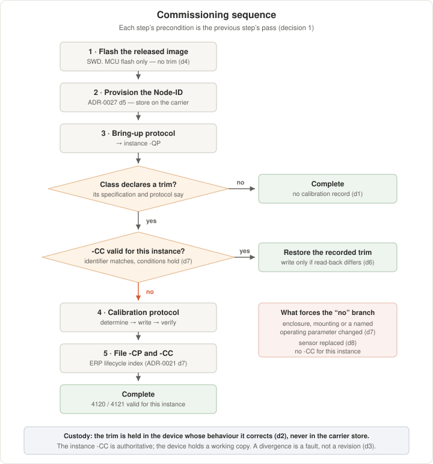

<!--
SPDX-FileCopyrightText: 2026 The IndustryGrow contributors
SPDX-License-Identifier: CC-BY-SA-4.0
-->

# ADR-0028 — Commissioning sequence and calibration-trim custody

- **Status:** Accepted
- **Date:** accepted 2026-08-28; changed 2026-10-19
- **Parent:** ADR-0017
- **Related:** ADR-0027 (Node-ID store and provisioning write; this realizes its provisioning tool), ADR-0014 (decision 6: the module EEPROM and its reserved address block), ADR-0021 (decision 7: the lifecycle-document index records are filed to), ADR-0029 (an update is not a commissioning event and preserves trims and Node-ID), ADR-0030 (the service tool that executes the protocol steps), ADR-0007 (secure-element scope)

## Context

ADR-0027 fixes Node-ID storage and the provisioning write. The M01 U3 temperature offset is the first calibration trim (M01 specification §10, O-45); its calibration protocol fixes how it is determined and verified and the `-CP` / `-CC` records it produces. No record fixes the order of flashing, provisioning, bring-up, calibration and filing; which store holds a trim; what a reflash, a module swap or a sensor replacement does to a trim; or when a recorded trim may be applied without re-determination.

A trim describes the module, while the ADR-0027 store describes the carrier (ADR-0027 decision 3). Re-determination costs hours of thermal equilibration (calibration protocol §5). Instance data belongs to the ERP and the repository holds procedures (ADR-0017 decision 21). The subjects O-45 names are invalid until a trim is in force.

| # | Device property | What it excludes | Source |
|---|---|---|---|
| P1 | A trim is measurable only on an assembled, running board at thermal equilibrium in its operating mode | Any sequence supplying a trim before the assembled board exists | Calibration protocol §4, §5 |
| P2 | The U3 sensor applies its stored offset internally and derives RH from the corrected temperature | Correction downstream of the device, which cannot reach RH | Sensor datasheet |
| P3 | The sensor's offset EEPROM has a finite write-cycle rating | Unbounded write frequency | Sensor datasheet |

## Decision

1. **Commissioning is an ordered sequence; each step's precondition is the previous step's pass.** Steps 4 and 5 are omitted for a class that declares no trim.

    | # | Step | Artefact |
    |---|---|---|
    | 1 | Flash the released image at manufacture, over the debug interface | — |
    | 2 | Provision the Node-ID | ADR-0027 decision 5 |
    | 3 | Execute the bring-up protocol | instance `-QP` |
    | 4 | Execute the calibration protocol, once per trim the class declares | instance `-CP`, `-CC` |
    | 5 | File the records | ERP (ADR-0021 decision 7) |

    

2. **A trim is held in the device whose behaviour it corrects.** The M01 U3 offset is held in the sensor's own EEPROM, not in the carrier store, which follows the carrier and not the module. Decision 10 covers a device with no writable store.
3. **The authoritative record of a trim is the instance `-CC`** (ADR-0017 decision 11). The device holds a working copy; where the two differ, the `-CC` governs and the difference is a fault, not a revision.
4. **No trim is written at flash time.** Trims are written over the bus, by command, on a running node.
5. **A device with no trim operates at its factory default and reports it.** Firmware does not write a default back; the boot log distinguishes the factory default from any other value and does not assert which run produced a value.
6. **A trim is written only when the device read-back differs from the intended value by more than the device's quantisation.** This bounds consumption of the P3 budget.
7. **A recorded trim is applied without re-determination only if the instance identifier matches and every validity condition named in its `-CC` holds.** Enclosure, mounting and any operating parameter the `-CC` names are validity conditions; a change to one voids the `-CC`, and the trim is re-determined, not restored. A `-CC` may state a period, a set of conditions, or both, and is void when either is exceeded.
8. **Sensor replacement voids the trim.** The replacement holds its factory default and is not the part measured, so decision 7's conditions cannot hold.
9. **The commissioning tool is an operator tool that sequences decisions 1–7 and refuses a restore whose conditions fail.** It does not allocate identifiers (ADR-0027 decision 7) and does not determine trims.
10. **Where the corrected device has no writable store, the trim lives in a serial EEPROM on the module, in the address block ADR-0014 decision 6 reserves.** The M04 thermal imager's EEPROM holds factory calibration and has no user cell for its flat-field correction. The module-resident store keeps decision 2's property — the trim travels with the module it describes — and is not the ADR-0027 carrier store.
    - Byte 0 of that EEPROM remains the class ID of ADR-0014 decision 6; fitting one is within that decision.
    - A module without such a store declares no trim (decision 5); decisions 3–9 apply unchanged.
    - The write mechanism for a trim too large for a register is fixed by the class specification (ADR-0000 decision 2).

## Alternatives

| Dec | Rejected alternative | Why rejected |
|---|---|---|
| 2 | **A.** Hold trims in the ADR-0027 carrier store | Lifecycle mismatch: the store follows the carrier and a trim describes the module; a swapped module is silently corrected by another board's value |
| 2 | **C.** Hold the trim only in the ERP and apply it at each boot | Published values would depend on gateway reachability at boot; by P2 the device holds a copy regardless |
| 2 | **D.** Correct downstream, in the gateway | P2: only correction upstream of the device's RH derivation reaches both quantities |
| 4 | **B.** Supply the trim at flash time from a build-time table | P1: the value does not exist before the assembled board is at equilibrium; spends a write cycle per flash, against decision 6 |
| 7 | **E.** Re-determine at every commissioning, with no restore path | Charges a full determination to a routine reflash; the `-CC` already carries the conditions under which a value stays valid |
| 7 | A validity period as the only voiding criterion | Suits a probe that drifts on a schedule; a fixed offset is voided by a change in its measurement conditions |
| 10 | **F.** For a device with no store, hold the trim at the gateway and correct there | Published values would depend on which gateway the module is attached to and the node's own statistics stay uncorrected; the correction stops travelling with the module |

## Consequences

**Positive**

- Commissioning has a fixed order that the tool implements rather than defines.
- A trim cannot be applied to a module it was not measured on.
- Flashing and Node-ID provisioning are independent of trims, and a firmware update is not a commissioning event (ADR-0029).
- O-45's subjects become valid for an instance when its `-CC` is filed, and for that instance only.

**Negative**

- Trim custody is split between the device and the ERP, and divergence detection is new work.
- A class whose device holds no store carries an EEPROM it would not otherwise fit, and a second store to keep consistent with its `-CC`.
- Sensor replacement costs a re-determination.
- The tool needs ERP read access at commissioning.
- A class that declares a trim cannot be commissioned by flashing alone.

## Deferred

| Open question | Settled by |
|---|---|
| The commissioning tool's interface and transport | An operational specification (ADR-0030, service-tool specification) |
| Where a device-versus-record divergence is detected and reported: node diagnostic channel or gateway | Maintainers, with the first divergence-detection implementation |

## References

- `store/E0002-000001-M-calibration-protocol.md` — the M01 U3 offset procedure and its records.
- `spec/E0002-R-specification.md` — §10 and O-45.
- `spec/E0005-R-specification.md` — the flat-field trim of decision 10, its store, and O-99.
- ADR-0027, ADR-0029.
