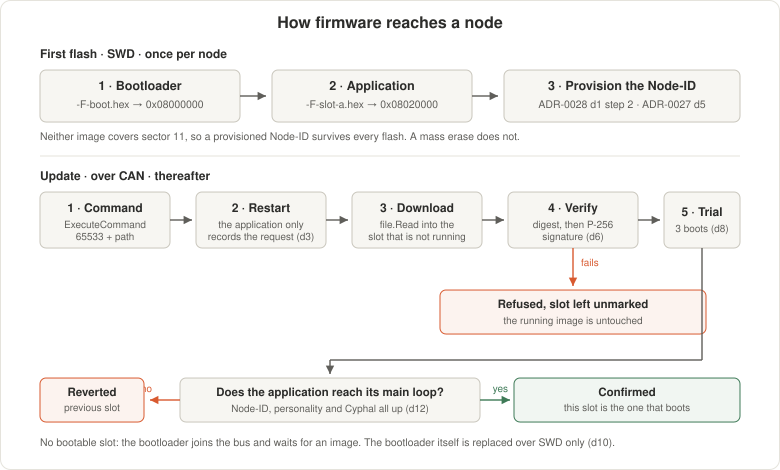

<!--
SPDX-FileCopyrightText: 2026 The IndustryGrow contributors
SPDX-License-Identifier: CC-BY-SA-4.0
-->

# ADR-0029 — Node firmware update and bootloader

- **Status:** Accepted
- **Date:** accepted 2026-08-28; changed 2026-10-19
- **Parent:** ADR-0004
- **Related:** ADR-0002 (bus rate; firmware distribution below telemetry priority), ADR-0005 (pinned regulated DSDL set; the update service binding it defers here), ADR-0007 (P-256; firmware root separate from identity), ADR-0015 (fail-closed precedent for decision 17), ADR-0017 (firmware identity follows the carrier), ADR-0020 (operational stream reaches a record at stage 11), ADR-0021 (intended-release entity), ADR-0022 (intent routes; exclusion of firmware-flash intake), ADR-0024 (bootloader-signing key custody), ADR-0025 (P-256 / SHA-256 signing), ADR-0027 (Node-ID store an update preserves), ADR-0028 (commissioning interaction it defers here)

## Context

ADR-0004 dec 12–16 fix build-time signing by an offline key, distribution by the Cyphal file transfer service, per-node verification before flashing, bootloader replacement over SWD only, and update events reported platform-side; dec 17 trusts the in-cabinet bus against injection. ADR-0027 dec 4 forbids an update from erasing the Node-ID store. Left open are flash partitioning, behaviour on a part-way failure, which component downloads and writes, whether an updated node is re-commissioned, which DSDL types carry the transfer, and how the gateway learns what to send and when.

| # | Property | Source |
|---|---|---|
| P1 | One flash bank with no read-while-write: code cannot execute from flash while flash is erased or written | RM0090 |
| P2 | Erase granularity is the sector; sectors are unequal in size | RM0090 |
| P3 | The last sector is reserved for the flash-resident Node-ID store and must survive an update | ADR-0027 dec 2, 4, 11 |
| P4 | Classic CAN; a node is addressable only while a Cyphal stack runs on it | ADR-0002 |

P1 excludes in-place rewrite of the running image, P2 puts partition boundaries on sector edges, P3 excludes the last sector from every write path, and P4 requires the downloading component to be a Cyphal node. Project cryptography is ECDSA P-256 over SHA-256 (ADR-0007 dec 1–2; ADR-0025 dec 9). SWD recovery requires physical access to the node.

## Decision

1. **Flash is partitioned at sector boundaries.** Sector edges and sizes are fixed by the part; the application links to a slot base and relocates its vector table.

    | Region | Sectors | Size | Written by |
    |---|---|---|---|
    | Bootloader | 0–3 | 64 KB | SWD only |
    | Update state | 4 | 64 KB | bootloader, application |
    | Slot A | 5–7 | 384 KB | bootloader |
    | Slot B | 8–10 | 384 KB | bootloader |
    | Identity | 11 | 128 KB | application (ADR-0027 dec 5); reserved and unread where the store is off-chip |

    

2. **Two application slots, with rollback.** The bootloader selects the slot from the update state; a slot is written only while the other holds the running image (P1).
3. **The bootloader downloads and writes; the application writes no slot.** The application records an update request in the update state and restarts.
4. **The bootloader is a Cyphal node** (P4): it publishes heartbeat, answers node info, and is a file-read client. It joins under the Node-ID from the ADR-0027 store, or the reserved unprovisioned Node-ID (ADR-0027 dec 6).
5. **DSDL binding: the standard execute-command service with the begin-software-update command, and the standard file-read service**, from the pinned regulated set (ADR-0005 dec 2, 10). The command carries the artifact path.
6. **An image is verified by ECDSA P-256 signature over the SHA-256 of header and body before its slot is marked bootable.** The verification key is held in the bootloader (ADR-0004 dec 14). A failed image is discarded, its slot left unmarked, and the previous slot runs.
7. **The image header carries magic, header version, image length, target hardware class, image version, SHA-256 digest and detached signature.** A header whose target class does not match the node is refused; byte layout is an implementation specification (ADR-0000 dec 2).
8. **A newly written slot boots in trial state and must be confirmed.** An unconfirmed slot is reverted at the next boot, and a bounded attempt counter in the update state ends a boot loop. Each boot checks a CRC-32 over the selected slot; the signature is checked on download only.
9. **An update is not a commissioning event.** Node-ID survives by decision 1 and P3, and a calibration trim is held in the device it corrects (ADR-0028 dec 2), so an update does not void a `-CC`. ADR-0028 dec 1 step 1 remains the manufacture-time SWD flash of bootloader and first image.
10. **The bootloader is not an update target over the bus.** Its sectors lie outside both slots and replacement requires SWD (ADR-0004 dec 15); the debug header is reachable with the carrier mounted.
11. **The node reports the verification result and resulting image version on its diagnostic channel** (ADR-0004 dec 16).
12. **A trial slot is confirmed by the application reaching its main loop: a provisioned Node-ID, a resolved personality, and the Cyphal node up.** An image that faults, hangs or boot-loops never reaches it and is reverted by decision 8's counter. The gateway takes no part, so a node updated with no gateway present keeps its image.
13. **A release publishes the bus artifact beside the flashable one, per application slot.** The bus form is header plus body — the unit a signature covers and the only form a node is given over the bus; the flashable form carries its own load address. The bootloader ships flashable only (decision 10).
14. **The gateway obtains artifacts from the ERP and holds them on disk**, as it obtains the active profile (ADR-0021 dec 8). ADR-0004 dec 13 fixes that the gateway holds and serves artifacts; this fixes the source, so no third party holds firmware.
15. **What a node runs is observed at the gateway, never assumed.** The gateway compares the running image CRC the node reports against the artifacts it holds — an exact comparison, not a version two sides could increment differently. The observation is operational and stays out of the ERP (ADR-0022 dec 8, 9); it reaches a system of record at stage 11 with the operational stream (ADR-0020 dec 9).
16. **A transfer starts from an operator's selection recorded in the ERP; the gateway performs it.** The gateway compares the intended release (ADR-0021 dec 18) against decision 15's observation, fetches the artifact, sends the update command and serves the file. Pull by the component that owns the bus, on a record the operator changed.
17. **The gateway identifies the running image by its CRC and serves the intended release's artifact for the other slot; an image it cannot identify stops the update for that node.** The node chooses the target slot (decision 3), the gateway chooses the file, and nothing on the bus names the running slot — matching the CRC against held headers names release and slot in one comparison. A wrong-slot image verifies, fails its trial and is reverted without a reason reported, so the gateway refuses, names the node and CRC, and leaves recovery to an SWD flash or to making the running release available (fail-closed, as ADR-0015 dec 7).

## Alternatives

| Dec | Rejected alternative | Why rejected |
|---|---|---|
| 1 | **F.** Update state in the identity sector | P3 |
| 2 | **A.** One slot, updated in place | P1: an interrupted write leaves no bootable image |
| 3 | **B.** Application self-update executing from RAM | Unrecoverable on power loss mid-erase |
| 4 | **C.** The MCU's ROM system bootloader over CAN | Bound to CAN pins the carrier does not route to the bus (AN2606), and cannot verify a signature (ADR-0004 dec 14) |
| 4 | **D.** USB DFU per node | Physical access per node; retained as a recovery path |
| 6 | **E.** Unsigned images under ADR-0004 dec 17 | dec 17 covers wire injection, not a corrupted or substituted artifact |
| 15 | Infer a node's version from the last command sent | A reverted trial, an SWD flash and a failed download all leave a node running something else |
| 15 | Report the observed version to the ERP for recording | Operational intake, excluded by ADR-0022 dec 9 |
| 16 | Push from a system that cannot see the node | The component that owns the bus is the one that can compare and pace the transfer |
| 17 | Assume slot A for an unidentified image | Wrong for every node that has updated an odd number of times |
| 17 | Try one slot, then the other | Spends a full transfer and a deliberate failed trial boot to learn one bit |

## Consequences

**Positive**

- A failed update leaves the previous image bootable, with no SWD access required.
- Node-ID and trims survive by construction.
- Flash writing and signature verification live in one signed component.
- A wrong-class image is refused before execution.
- The bootloader runs before the watchdog is started; the application starts it, so a transfer is not bounded by it.

**Negative**

- The application is relocated off the flash base and the linker script, release artifact and SWD procedure change with it.
- A second signed component enters the build and the key ceremony.
- A bootloader defect requires physical access to correct.
- The Cyphal skeleton is linked into both images, at the cost of bootloader space.
- First flash is two artifacts.
- A node running an image the gateway does not hold is not updated over the bus.

## Deferred

| Open question | Settled by |
|---|---|
| Measured bus occupancy of a full image transfer, by the bit accounting ADR-0002 applies to telemetry | Maintainers, on the bench |
| Fleet-wide update order and concurrency | Maintainers, before a fleet update |
| Bringing a node with an unrecognised image back under decision 17 without SWD: the running slot published on the bus, or more release history at the gateway | Maintainers, when it recurs |

## References

- `firmware/common/platform/partition.h`, `firmware/common/platform/image.h` — partition and header layout.
- `firmware/boot/` — the bootloader; `gateway/firmware_client.py` — decisions 14–17 at the gateway.
- `store/E0001-000003-D-pinmap.md` — CAN, SPI and SWD pins on the carrier.
- ST RM0090 Table 5, *Flash module organization*; section *Erase and program operations*.
- ST AN2606 Table 50, *STM32F40xxx/41xxx configuration in system memory boot mode*.
