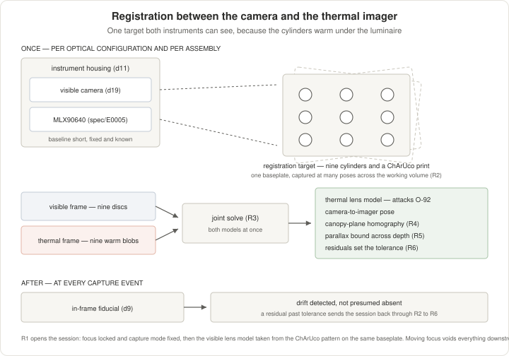

<!--
SPDX-FileCopyrightText: 2026 The IndustryGrow contributors
SPDX-License-Identifier: CC-BY-SA-4.0
-->

# ADR-0033 — Canopy imaging channel

- **Status:** Proposed
- **Date:** proposed 2026-09-08; changed 2026-10-19
- **Parent:** ADR-0001
- **Related:** ADR-0003 (phase-dependent spectrum d11 and DLI target d12 that decisions 3 and 4 work against), ADR-0014 (d9 places the camera outside the Cyphal taxonomy), ADR-0015 (d1 profile channel that carries the schedule), ADR-0016 (lifecycle phases and soft-sensor rule decisions 16–17 apply), ADR-0017 and ADR-0019 (numbering at design or selection commit), ADR-0020 (d4 survey-storage premise that decision 15 bounds), ADR-0028 (commissioning of registration), ADR-0031 (`A02-LIGHT` that decision 14 places a requirement on; command rules), ADR-0032 (enclosure envelope)

## Context

Every sensor and actuator class observes or drives the input side or the apparatus; nothing observes the response side, the plant. M04's thermal statistics are frame-wide because no canopy segmentation exists (`spec/E0005` `O-88`), which bounds the meaning of every statistic, leaf VPD and hotspot reading. Leaf area is measured nowhere, so its growth sits in the estimator residuals ADR-0016 d7 monitors, indistinguishable from an equipment fault.

An analysis method can be chosen later from data that exists; capture fidelity that was never recorded cannot be recovered. This record therefore fixes the capture contract and leaves the analysis method open. A camera's own signal processing compensates away the quantity being measured, so "no automatic correction" is a configuration property that must be stated. The cultivation luminaire is the only light source in the volume, so the illuminant is a profile-controlled factor unless the capture takes it out of the recipe. `A02-LIGHT` has no specification yet, so a requirement on it is cheap to place.

Out of scope: replacing or validating away any environmental sensor (a correlation with the response side shows the plant responds, not that a sensor is surplus); any phenotypic or physiological claim; any change to `E0005`'s electrical design or M04's radiometric accuracy; and pre-allocation of part or assembly numbers.

## Decision

1. **This record owns the visible-light imaging channel, and the camera is a gateway instrument, not a node.** It has no module class, no module-ID strap, no carrier header signal and no Cyphal subject of its own (ADR-0014 d9).
2. **A capture is an atomic instrument event at a fixed clock phase.** All frames of one event share one pose, one optical configuration and one mask; exposure, gain and illumination provenance are fixed per band and recorded per frame.
   - Step 1: the M04 thermal frame, under the luminaire state the recipe left, so the imager's settling requirement is met against prior conditions and canopy temperature is taken under the light the crop lives under.
   - Step 2: dark frame, all channels off.
   - Steps 3…n: one exposure per luminaire channel, that channel alone energised.
3. **From step 2 on the luminaire is driven to a fixed capture state independent of the active recipe, and the recipe is restored afterwards.** The recipe's spectrum is phase-dependent (ADR-0003 d11), so a capture under it would co-vary with the variable the channel correlates against.
4. **Capture events fall inside the photoperiod, and their light is accounted against the DLI target.** Firing the luminaire in the dark period is a photoperiodic intervention tolerable only for some cultivars, so it cannot be a platform default. The debit is event duration times event count against ADR-0003 d12; the figures are profile and implementation values.
5. **No image signal processing in the measurement path.** Raw sensor data, no demosaic; automatic exposure, gain, white balance, HDR merge and lens-shading correction off or bypassed; statistics per colour plane. Each of those is a scene-dependent correction moving with the measured quantity, so leaving one on removes the signal and leaves a plausible image.
6. **Every frame contains a reference surface in the canopy plane, carrying several patches of known reflectance.** The luminaire lights from above, so a reference at another height is not lit like the subject; the target is luminaire and optical-path degradation over a cycle, which an installation-time calibration cannot observe. Several known chromaticities give a colour-correction matrix for decision 19; one neutral patch gives only a white balance.
7. **M02-LIGHT's reading at the capture instant is recorded with the event.** The reference surface returns the gain of the illumination-and-optical path; M02 returns the spectral composition at the canopy (ADR-0014 d4); neither substitutes for the other.
8. **Flat field per optical configuration, dark frame per event, scene illumination non-uniformity characterised once per installation.** The luminaire is not coaxial with the camera, so its non-uniformity is separate from the lens's; it is fixed, so it is stable.
9. **Pose and optical configuration are fixed and monitored.** In-frame fiducials detect pose drift; mechanical settings are locked, software settings are fixed by configuration and recorded with the frame.
10. **Segmentation is part of the measurement chain and is versioned; raw frames are retained.** The mask method and version are recorded with every derived value, and values with different mask versions are not comparable. The mask comes from the white-channel frame and applies to the whole event, since geometry is constant within an event and a mask under one narrowband channel is undefined; retained frames make re-segmentation possible.
11. **The camera and the M04 imager share one housing, on separate boards.** At the working distance of `spec/E0005` §6.6 one thermal pixel spans tens of millimetres of scene, so board-level co-location buys no observable registration accuracy; overlay accuracy is bounded by aperture parallax against canopy depth, which a short known baseline controls. The housing is a mechanical assembly and takes an E-number at design commit (ADR-0017 d5).
    - A short, known, fixed baseline between every pair of apertures.
    - A thermal break between camera and imager.
    - One optical window per path: long-wave-infrared for the imager (`spec/E0005` M2), decision 18's band set for the camera.
    - No encroachment on the imager's obstacle-free cone (`spec/E0005` §9 M1).
12. **The mask registers onto the M04 thermal frame through a homography established at commissioning against one target both instruments see.** Registration changes which pixels enter a statistic, not M04's radiometric accuracy (`spec/E0005` §6.3), and leaf VPD stays deferred to ADR-0014 d4's pipeline. The target is one baseplate carrying nine raised cylinders (warm blobs to the imager, discs to the camera) and a ChArUco pattern formed on the part, so feature spacings come from the part's drawing. The session runs once per optical configuration and per assembly, and again only when the fiducials of decision 9 report a residual past tolerance.
    - R1: lock focus and capture mode; camera intrinsics and distortion from the ChArUco pattern.
    - R2: cylinder-target pairs at many poses across the working volume, luminaire on and settled.
    - R3: solve the imager's lens model and the camera-to-imager pose together; this supplies the distortion model the imager lacks (`spec/E0005` `O-92`).
    - R4: project onto the canopy plane, giving the homography.
    - R5: sweep the target through the depth range, giving decision 11's parallax bound.
    - R6: residuals over the nine features, giving the registration tolerance (`O-120`).
13. **The capture schedule is a profile field.** A capture changes luminaire state, and the signed profile is the only channel that changes deployment behaviour (ADR-0015 d1).
14. **`A02-LIGHT`'s specification shall provide per-channel addressing, a capture state reachable independently of the recipe, and recipe restoration, with a sequence short enough that decision 4's debit stays negligible.** This is a requirement on an unwritten specification, not a design, and does not change ADR-0031.
15. **Raw imagery is a distinct ADR-0020 storage purpose, time-boxed to survey campaigns.** Its volume is not modest, so ADR-0020 d4's volume premise does not cover it; the store stays best-effort (ADR-0020 d3). Retention is bounded per campaign, not by capacity; the bound and export path are implementation values.
16. **Everything derived from imagery is published as estimated, never as measured (ADR-0016 d5).** A quantity fitted against a sensor's readings is not an independent measurement of it, and the data model keeps that distinction regardless of fit quality.
17. **Lifecycle placement is not decided here.** The channel is survey-phase instrumentation (ADR-0016 d1); whether it joins the operating-phase minimum set is an identification output (ADR-0016 d2), and the shared housing does not bind both instruments to one lifecycle.
18. **The optical path passes white, red and far-red and carries no infrared-cut filter; it is not required to pass ultraviolet.** A standard infrared-cut filter removes the far-red channel the profile commands, and silicon responds past it. Colour-filter dyes, ordinary cover glass and lens cement cut the ultraviolet-A band, reaching it needs UV-grade monochrome-class optics against decision 19, and no decision consumes the band. The requirement holds for the whole path — sensor cover glass, lens coatings and housing window — and with no cut filter, only decision 3's one-channel sequencing separates bands.
19. **The detector is a colour sensor; the ordinary colour image is a derived product of the white-channel frame.** The luminaire has no green or blue channel, so a monochrome detector cannot reconstruct colour under it by any sequence, and colour is required for disease and disorder recognition, human review of flagged residuals and pretrained vision models. The viewable image is demosaiced and colour-rendered by a fixed transform computed once against decision 6's patches; a constant transform under a fixed illuminant is outside decision 5's measurement path, and the raw planes stay the measurement.

## Alternatives

| Dec | Rejected alternative | Why rejected |
|---|---|---|
| — | **I.** Defer the channel until an analysis method is chosen | The method cannot be chosen without data, and the contract produces the data |
| — | **K.** A directional note inside ADR-0016 | A storage purpose, a requirement on an actuator specification, a mechanical assembly and a commissioning step exceed a direction |
| 1 | **A.** The camera as a Cyphal node | ADR-0014 d9 places it outside the taxonomy, and its payload is incommensurate with classic CAN (ADR-0002) |
| 2 | Thermal frame under the capture state | Canopy temperature under a synthetic illuminant characterises the apparatus, not the plant |
| 3 | **D.** Capture under the active recipe's spectrum | The illuminant co-varies with a profile-controlled factor, and three broad colour planes cannot invert a spectral change |
| 3 | **F.** A dedicated imaging illuminator | Not adopted: a second heat source in the housing and a second thing to calibrate and age; reopens if the far-red channel proves insufficient (`O-122`) |
| 4 | **E.** Capture in the dark period | A photoperiodic intervention whose tolerability rests on a cultivar property |
| 6 | Reference surface away from the canopy plane | It is not lit like the subject it normalises |
| 6 | Calibration once at installation only | Cannot observe luminaire and optical-path degradation over a cycle |
| 6 | One neutral reference patch | Fixes per-channel gains only, a white balance, not a colorimetric render |
| 10 | Mask computed per narrowband frame | A mask under one narrowband channel is undefined, and geometry is constant within an event |
| 10 | **H.** Derived features only, frames discarded | Freezes the segmentation method, since a superseded method cannot be re-run on discarded data |
| 11 | **B.** The camera on the `E0005` PCB | No observable registration gain; adds a heat source `spec/E0005` T2 forbids, a periodic disturbance to T3's settled conditions, a CSI link the ADR-0014 d5 header lacks, a populate variant (ADR-0017 d4) and two obsolescence horizons on one revision |
| 11 | **C.** Two independently mounted instruments | The baseline becomes an installation property, re-established per installation and after any service |
| 12 | Printed registration pattern | Black and white ink differ negligibly in emissivity, so the imager cannot see it |
| 12 | Plain chessboard or a second physical target for the camera | A plain chessboard loses partly occluded views across R2's pose range; a second target adds a part and a session |
| 12 | Pattern on a sheet adhered to the baseplate | Reintroduces the measurement the part drawing exists to avoid |
| 12 | Re-registration on a fixed schedule | The in-frame fiducial reports drift continuously; a residual past tolerance calls for a repeat |
| 15 | **G.** Compressed storage | Chroma subsampling and lossy coding destroy the measured statistic and prevent re-segmentation |
| 18 | **J.** A sensor with an infrared-cut filter | Removes the far-red channel (ADR-0003 d11) on the red edge, foliage's strongest feature; preferable only without decision 3's sequencing |
| 18 | **L.** Ultraviolet-A as an imaging or fluorescence band | Not adopted: a non-destructive proxy for the traits the UV trace targets, but fluorescence under a trace dose is not established as measurable, a higher dose is a photobiological intervention, and an invisible light leak swamps it (`O-118`); reopens on a measurability result |
| 19 | Monochrome detector | Cannot reconstruct colour under a luminaire with no green or blue channel |

## Consequences

**Positive**

- `O-88` gains a path: a segmentation source exists and registers onto the thermal frame.
- Leaf area becomes observable, moving a known drift term out of ADR-0016 d7's residuals into the state, within the bound of `O-125`.
- Whole-canopy visual failure modes gain coverage no scalar sensor provides.
- Crop-response research (`project/RESEARCH.md`) gains a non-destructive observation channel.
- The `A02-LIGHT` requirement is placed before that specification is written.
- The capture state makes the canopy image comparable across the cycle under a phase-dependent recipe.
- The reference surface sits in both fields of view and is a candidate input to `O-87`'s emissivity and reflected-temperature placeholders.

**Negative**

- The enclosure acquires a stray-light expectation ADR-0032 and `spec/E0011` do not carry, and with no infrared-cut filter a leak invisible to an inspector lands in the far-red measurement (`O-118`).
- ADR-0020's sizing argument holds per storage purpose, not globally.
- M04 statistics acquire a versioned dependency on a mask produced outside M04; an unversioned mask change invalidates a series.
- Commissioning gains a registration step whose tolerance is unset (`O-120`, ADR-0028).
- The delivered light integral carries a recurring debit accounted per decision 4.
- The housing adds a mechanical assembly with optical, thermal and registration requirements to design and release.
- A capture couples measurement to actuator state; decision 13 routes the coupling through the profile without removing it.

## Deferred

| Open question | Settled by |
|---|---|
| Whether the channel sequence is admissible under ADR-0031 d5's dead band, dwell at zero and validity deadline (`O-117`) | `A02-LIGHT` specification |
| Stray-light expectation on the enclosure (`O-118`) | ADR-0032 / `spec/E0011` |
| Housing windows, thermal break, condensation handling (`spec/E0005` `O-90`), M1 clearance, and the reference surface's form, patch count, reflectances and stability (`O-119`) | Housing design |
| Registration tolerance over R6's features and the operator response when exceeded (`O-120`) | ADR-0028 commissioning step |
| Method and interval for characterising scene illumination non-uniformity (`O-121`) | First installation |
| Whether far-red gives enough red-edge contrast without a true near-infrared band (`O-122`) | Survey data; decides whether alternative F reopens |
| Retention bound and export path for raw frames (`O-123`) | Gateway implementation |
| Projected area saturates at canopy closure, in the fruiting phase; a second visible instrument on a known baseline would give height and volume (`O-125`) | Survey data |
| A cultivation-run entity, on which comparability across runs rests | Data model owner |

## References

- `spec/E0005-R-specification.md` — §3.2, §6.3, §6.6, §9 M1, M2, T2, T3, `O-87` to `O-97`, `O-119`.
- `project/ROADMAP.md` — imaging rollout phases P1–P4.
- `project/RESEARCH.md` — L5, crop-response identification.
- `gateway/canopy_capture.py` — P1 capture with pinned exposure, gain, white balance and focus.
- `profiles/strawberry-day-neutral-v1.json` — luminaire band set.
